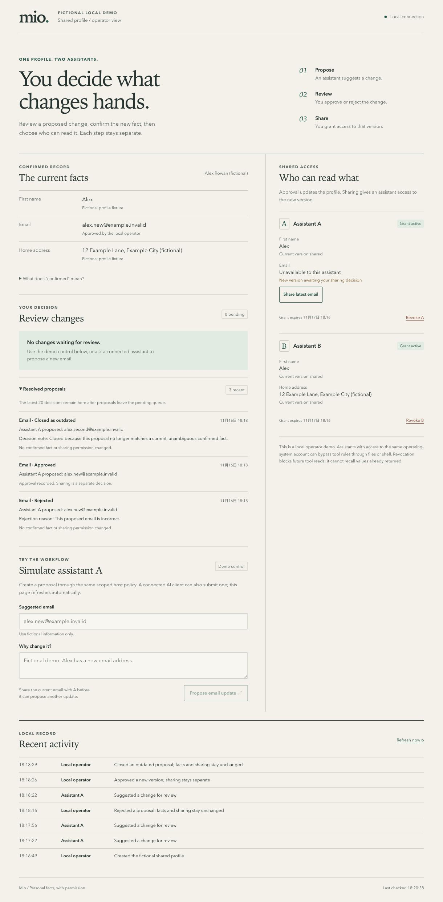

# Mio

**A user-controlled personal data layer for AI.**

[简体中文](README.zh-CN.md) · [Connect your AI](docs/INTEGRATIONS.md) · [Architecture](docs/ARCHITECTURE.md) · [Validation](docs/VALIDATION.md) · [Security](SECURITY.md)

Mio gives people a local, structured place to keep facts about themselves, the evidence behind those facts, and proposed updates from AI assistants. Applications can request selected information for a task, while a separate operator workflow handles review and sharing.

The goal is to let people carry their information between AI assistants and decide what each task may use.

**Status: `0.3.0-alpha` — an identity-first Alpha.** This repository contains a SQLite core, JSON contracts, a local MCP adapter, and executable examples with fictional data. Broader preference and relationship models, remote authentication, and production security controls remain roadmap work.

## Start the shared-profile trial

Use **Node.js 24**, npm, and Git. The commands below are for macOS/Linux POSIX shells and download the **unreleased trial branch**, not the older `v0.3.0-alpha` release. Run them from a directory where you want a new checkout:

```sh
git clone --branch codex/shared-profile-trial --single-branch https://github.com/EUMINZ/mio-personal-data.git mio-personal-data-trial
cd mio-personal-data-trial
git rev-parse HEAD
npm ci --ignore-scripts
mio_trial_dir="$(mktemp -d)/profile"
npm run demo:shared -- "$mio_trial_dir"
```

Record the printed commit for feedback: the trial branch can change. `mktemp` creates an empty parent outside the checkout; the launcher creates a new fictional profile inside it. Keep the terminal running and open the printed local review URL. Keep that URL private because it authorizes operator actions.

The [shared-profile example](examples/shared-profile/README.md) gives A name/email access and permission to propose changes; B can read name/address from the same persistent SQLite database. Approval creates a confirmed version, separate sharing makes that version readable to A, and revoking A leaves B's grant unchanged. You can also **reject a proposal with a reason** or **close an outdated proposal**; neither operation changes confirmed facts or grants. Handled proposals remain in the decision history.

Choose one way to try it:

- **Local walkthrough:** use the page's simulated proposal control. No model account, API key, or model call is needed.
- **Real MCP clients:** copy the complete **Codex A** and **Claude Code B** commands printed by the launcher into separate terminals. Paths are filled in for your checkout and profile; user-level registrations are not changed. Client login and model access are required and may consume account usage.

Follow the [15–20 minute trial guide](docs/SHARED_PROFILE_TRIAL.md) for the exact scenario and feedback form. To print the client commands again, run `npm run demo:shared:commands -- /absolute/existing-demo-directory` from the checkout, using the profile directory printed at startup. This does not create a profile or renew a grant.



The initial fictional workflow passed automated and browser checks. A real Codex client completed A's lifecycle; Claude Code B was blocked by authentication before tool use, so B was checked separately with the MCP SDK. **A complete two-model trial and independent external user trials remain unverified.** The [sanitized validation record](docs/trials/shared-profile-live-validation-2026-11-16.json) describes that earlier snapshot; see [validation](docs/VALIDATION.md) for checks of later changes.

## Released simulation and development checks

To reproduce the older **in-memory mock-assistant simulation**, use a separate checkout:

```sh
git clone --branch v0.3.0-alpha --single-branch https://github.com/EUMINZ/mio-personal-data.git mio-personal-data-v0.3
cd mio-personal-data-v0.3
npm ci --ignore-scripts
npm run demo
```

That release has no shared-profile review page and no `demo:shared` script. The [two-assistant simulation](examples/two-assistants.js) needs no model downloads or API keys and makes no model calls. The core and that simulation have no third-party runtime dependencies; the MCP adapter and review example use the official MCP SDK and validators installed by npm.

In either checkout, `npm run check` runs syntax checks, the tests available in that version, and the mock-assistant simulation. See the [validation record](docs/VALIDATION.md) for tested environments and limits.

## Connect your AI

Mio exposes a local **stdio MCP server** for Codex, Claude Code, and other compatible clients. Follow the [installation guide](docs/INTEGRATIONS.md) for client registration, a pinned GitHub package option, and personal-profile setup.

The default interface has two tools:

| Tool | Purpose |
| --- | --- |
| `mio_context` | Discover readable keys with `{}`, or request a batch of selected `fields`. |
| `mio_propose_update` | Record a pending proposal for operator review. |

The demo server entrypoint is:

```sh
node adapters/mcp/server.js --demo
```

This command speaks MCP over stdio and waits for a client; use `npm run demo` for the standalone demonstration. Each demo server process starts its own independent fictional, in-memory database.

Context reads return allowed values, a uniform `unavailable` key list, and `checkedAt`. Reads are not cached. An invalid overall grant or a database/audit error fails the whole call. The timestamp records a permission/read check, not proof that a fact is true or current. The [integration guide](docs/INTEGRATIONS.md) explains the field policy and the optional `--legacy-tools` interface.

**Approval and sharing are separate operator actions, outside MCP.** The operator CLI applies an approved change transactionally; sharing the updated value requires a subsequent explicit action.

GitHub distributes the code. The database stays on your machine, but authorized tool results enter your chosen AI client's context and may reach its model provider. MCP checks do not isolate the database from an assistant with shell or file access under the same OS account.

## What Mio provides

| Capability | Current scope |
| --- | --- |
| Claims and evidence | Structured identity, contact, and employment facts, with source links, status, and timestamps. |
| Review | Proposed changes, pending queues, decisions, and decision receipts. |
| Grants and audit | Records of requesters, purposes, permitted claims, expiry, revocation, and events. |
| Wiki and notes | Contextual entries and constrained explanatory notes alongside structured facts. |
| Views and search | Compiled summaries, timelines, Markdown dossiers, and exact, keyword, or alias-based semantic search. |

The workflow separates evidence, suggestions, confirmed facts, and permission to share:

```text
Evidence → Proposed update → Operator review → Confirmed fact
                                                   ↓
                                           Explicit sharing
                                                   ↓
                                        Scoped context for AI
```

A core review decision is a workflow record: recording acceptance alone does not change a canonical claim. A trusted host must apply that change separately; the MCP operator CLI provides an implementation of this step.

## Repository layout

| Component | Role |
| --- | --- |
| [mio-core](mio-core/README.md) | Local SQLite storage, repository API, importers, search, and CLI. |
| [contracts](contracts/README.md) | Versioned JSON formats for context and review exchange. |
| [adapters/mcp](adapters/mcp/) | Local stdio tools and separate operator administration. |
| [examples](examples/) | Fictional, executable integration examples. |
| [benchmarks](benchmarks/README.md) | Reproducible comparison against a capable scoped JSON host. |
| [experiments](experiments/accuracy-cost/README.md) | Client integration and accuracy/cost evaluation. |

The public project focuses on the core, contracts, adapters, and examples, including the local review page above. It does not include the full product application, a mobile app, browser extension, or country-specific workflow.

Some API and contract names retain `Gemma` for compatibility. No Gemma model is required. Runtime validation is implemented in JavaScript; JSON Schema describes the exchange formats. See [contracts](contracts/README.md) for details.

## Trust boundary

Mio is an Alpha for local development and integration research. It has not undergone an independent security audit.

- **Storage is plaintext by default.** SQLite databases and generated exports are not encrypted by Mio.
- **The core API and CLI trust the host.** Context builders, search, and full exports are not permission-scoped APIs. Host applications must authenticate callers, enforce permissions, and control user approval.
- **Grant records are not authentication.** Actor identifiers and recorded permissions do not establish who is making a call.
- **MCP checks apply to tool calls.** The adapter enforces its configured grant, but an assistant with access to the same database, files, or operator CLI can bypass that boundary.
- **Audit records are mutable.** They live in the same database and are not a tamper-proof ledger.
- **Shared values cannot be recalled.** Revoking a grant does not remove copies already retained by a client or model provider.

Use fictional information while experimenting. Read [SECURITY.md](SECURITY.md) before integrating personal information.

## Validation and research

The evidence below describes specific checks and experiments, not a general claim of production readiness or better AI performance.

| Evidence | Finding and limit |
| --- | --- |
| [Automated validation](docs/VALIDATION.md) | The `0.3.0-alpha` record reports 110 passing tests, including MCP behavior. GitHub Actions runs the checks on Node.js 24. |
| [Unreleased shared-profile trial](docs/SHARED_PROFILE_TRIAL.md) | The current trial checkout passed 136 tests, including review rejection/closure and generated client commands. [Validation](docs/VALIDATION.md) separates these checks from earlier browser and partial real-client evidence; external adoption is untested. |
| [Architecture study (Chinese)](docs/research/mio-personal-data-layer.zh-CN.md) | Mio and a competent scoped JSON host produced identical outcomes on the tested policies. Both reduced unnecessary application payload compared with full-profile delivery; this does not establish unique performance superiority. |
| [Codex integration smoke test](experiments/results/codex-mcp-smoke.json) | A historical `0.2.0-alpha` session verified real tool integration, not comparative model quality. |
| [Accuracy/cost experiment](experiments/accuracy-cost/README.md) | In 40 real Codex sessions with the same model, tasks, and host policy, legacy completed 12/20 tasks correctly and compact completed 20/20 by avoiding omissions of readable fields. This small synthetic sample does not establish general model accuracy. |

In the accuracy/cost experiment, total input tokens fell **7.34%**, while uncached input rose **3.50%**. Lower actual per-request charges are not established. The [full study (Chinese)](docs/research/accuracy-cost-optimization.zh-CN.md) includes results and limitations.

## Direction

Next steps include:

- Evaluating outcomes across more real tasks and clients.
- Defining portable preference and relationship models.
- Adding authenticated remote integrations.
- Designing and validating encrypted storage, secure recovery, and migration policies.

## Contributing

Contributions that improve trust boundaries, reproducible examples, or interoperability are welcome. Start with [CONTRIBUTING.md](CONTRIBUTING.md), use fictional fixtures, and describe the checks you ran.

## License

Licensed under the [Apache License 2.0](LICENSE). See [NOTICE](NOTICE) for attribution.
