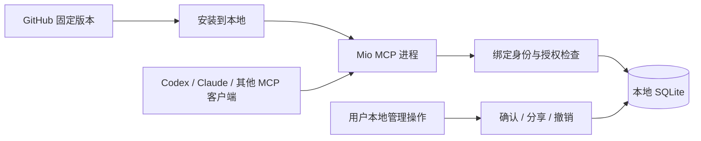

# 面向 AI 助手的个人信息层：Mio 的可复现评测与插件化实现

日期：2026-11-14 · 类型：工程实验报告 · 状态：Alpha，自评，未经独立同行评审

## 摘要

Mio 探索由用户维护个人事实、审核更新并按任务授权的共享数据层。本研究评估两个问题：这样的结构是否减少无关资料传递、是否能执行明确的更新与授权规则；以及能否通过插件接口供真实 AI 客户端调用。

我们构建了固定虚构资料的确定性对照：整份资料返回、具有同等规则的 JSON 宿主，以及 Mio 的 SQLite 核心与示例宿主。九次读取中，后两者的应用层响应均为 651 字节，整份返回为 5,460 字节；两种受限实现均通过 13 项生命周期案例。结果支持字段筛选与规则执行的作用，**没有证明 Mio 比正确实现的 JSON 方案更准确、更快或更省 token**。另一次真实 Codex MCP 调用完成了读取、越权拒绝、待审提议与原值保持，证明最小接入链可以运行。

Mio 当前最合理的工程价值，是提供可以跨客户端复用的事实、审核、授权和审计实现。减少集成开发工作及用户重复输入的效果，仍需独立接入者和真实任务验证。

## 1. 研究问题与边界

AI 助手使用个人信息时，至少涉及四个不同问题：哪一项事实有效、它来自哪里、谁可以读取、谁可以修改。把它们全部交给提示词，难以提供可复查的状态；把它们建成程序规则，又会给每个助手集成带来实现和维护工作。

Mio 将这些状态放入本地数据层：事实可以关联证据，修改建议先进入审核，授权指向具体事实版本，操作留下审计记录。它目前从身份和联系方式起步，尚不是通用偏好、关系和对话记忆系统。

本报告分别检验：

1. **资料最小化：** 相同任务是否收到更少的无关字段？
2. **生命周期控制：** 到期、撤销、更新和失败时，程序是否维持预期状态？
3. **接入可行性：** 真实 AI 客户端能否通过标准工具接口使用上述能力？

这三个问题不等价于模型问答质量。输入字段正确，也不保证模型采用它；撤销后拒绝新读取，也无法删除客户端已经持有的旧上下文。

## 2. 方法：保留一个有能力的对照方案

实验使用一个含 24 个虚构字段的固定资料，取其 3、12、24 字段前缀，分别执行姓名、姓名加邮箱、仅邮箱三类请求。九个组合是资料长度敏感性测试，**不是九位用户或独立随机样本**。邮箱使用 `example.invalid`，其他资料明确标为虚构。

| 实现 | 行为 | 比较用途 |
| --- | --- | --- |
| 整份资料参考 | 每次返回该资料中的所有字段，不检查授权 | 测量整包传递与按需传递的差别，不作为同等安全策略的竞争者 |
| 受限 JSON 宿主 | 自行实现确认版本、字段筛选、绑定、到期、撤销、审核、审计与失败回滚 | 同策略的有效对照，不导入 Mio 代码 |
| Mio 示例宿主 | 调用现有 scoped reader、审核导入器和 SQLite 核心事务 | 测量实际示例实现的行为 |

JSON 是存储格式，可以实现同样的规则。将对照故意写成直接覆盖资料、忽略授权的简单程序，会把策略选择误认为框架优势，因此本实验没有采用这种比较。

响应大小按 `Buffer.byteLength(JSON.stringify(response), 'utf8')` 计算，使用相同的 `{ "fields": ... }` 外层结构。它不包含系统提示词、工具定义、MCP/JSON-RPC 包装、模型输出或推理。生命周期案例使用固定时钟和显式模拟用户确认，每例重新初始化；故障案例在前序写入后注入审计失败，比较完整相关状态是否回滚。

运行环境为 Node.js 24.12.0、SQLite 3.50.4、macOS arm64。固定输入、各例实际响应、源码哈希和运行时间保存在[原始结果](../../benchmarks/results/architecture-results.json)，方法与复现细节见[基准说明](../../benchmarks/README.md)。

## 3. 结果

### 3.1 按需读取减少资料响应，但优势不由 Mio 独占

| 实现 | 九次读取合计字节 | 任务未请求字段的出现次数 | 缺失的请求字段 |
| --- | ---: | ---: | ---: |
| 整份资料参考 | 5,460 | 102 | 0 |
| 受限 JSON | 651 | 0 | 0 |
| Mio | 651 | 0 | 0 |

相对整份资料返回，两种受限实现均减少 **88.08% 应用层 JSON 字节**。在 3 字段资料上，整份响应每次为 116 字节；在 24 字段资料上为 1,124 字节。三个受限任务的响应始终分别为 66、89、62 字节。

该比例受资料长度、字段值长度和任务组合影响。它不能转换成“节省 88% 模型费用”或“性能提升 88%”，也不是 Mio 相对受限 JSON 的优势。完整工具调用可能增加额外往返、提示词和工具描述；本实验没有估计这些开销。

### 3.2 两种受限实现都满足所测规则

受限 JSON 与 Mio 均通过 **13/13** 生命周期案例，其中包括 8 项预期读取拒绝：范围外字段、错误请求方、错误人员、未知授权、到期、撤销、更新后仍使用旧授权，以及重新分享失败后的访问。

其余案例验证了正常读取、提议不改正式事实、新授权后的读取、审核失败回滚，以及另一个助手的无关字段不受更新影响。审核和重新分享中的同步异常，都没有留下半完成状态。

这些结果证明所测实现符合这组确定性要求，不是零漏洞证明或生产故障率。JSON 对照采用内存快照恢复，Mio 采用内存 SQLite 事务；没有测试掉电恢复、多进程竞争或恶意本地进程。

实验同时观察到一个代价：确认新邮箱后，旧授权不会自动获得新版本，用户需要再确认分享。这提供了明确的授权语义，也可能增加操作步骤。产品是否接受这一摩擦，需要用户研究。

### 3.3 真实 Codex 接入可运行

一次隔离的 Codex CLI 0.160.1 测试，以 `gpt-6-astra`、低推理配置运行虚构 `--demo` 数据。它实际完成五次 MCP 调用：列出字段、读取姓名和邮箱、请求未授权护照字段、提出邮箱修改、再次读取邮箱。

工具记录显示未授权读取被拒绝，修改进入 `pending`，后续读取仍返回旧的已确认邮箱。模型最终输出与工具记录一致。[调用证据](../../experiments/results/codex-mcp-smoke.json)保留了输入、工具输出和客户端计数。

这是一次客户端连通与功能验收，不是模型对照实验。CLI 的累计 token 计数包含其系统上下文、多轮调用和缓存，不可与上面的 651 字节相除推算节省比例。它也没有检验模型是否会自发选择 Mio、是否在长对话中持续刷新信息，或对提示注入是否稳健。

## 4. 插件化：让现有 AI 使用同一数据层

本轮采用本地 stdio MCP。GitHub 分发代码和版本，安装后的进程访问本地 SQLite；AI 客户端通过工具请求授权信息。



模型可见的接口只有三项：

| 工具 | 作用 |
| --- | --- |
| `mio_list_fields` | 返回当前配置允许读取的字段名 |
| `mio_read` | 返回本次请求且当前获准的已确认字段 |
| `mio_propose_update` | 记录待审修改，不确认、不覆盖正式事实 |

人员、请求方和授权绑定在本地配置中，模型不能通过工具参数自行换成另一个身份。确认、重新分享和撤销保留在本地管理 CLI。初次导入自己的资料时，操作者也必须明确选择字段范围。

**本地存储不等于资料永不离机。** 读取结果会进入所用 AI 客户端，并可能发送到其模型服务。具有同一操作系统账户下文件或 shell 权限的助手，也可能绕过 MCP 直接接触文件；本实现不是这样的进程之间的隔离边界。

每个 `--demo` 进程拥有独立内存数据。真实客户端使用相同配置文件时，共享同一数据库与同一请求方授权；分别管理助手权限需要分别绑定授权。不能把两个独立 demo 描述成已经完成了跨客户端同步。

Codex 官方支持本地 stdio MCP，Claude Code 可通过 MCP 配置或插件装载服务。具体安装、版本固定、客户端验证状态与限制以[接入说明](../INTEGRATIONS.md)为准。该方式不意味着已经进入官方插件目录，也不使仅支持远程服务的云端客户端自动获得本地文件访问能力。[Codex 官方说明](https://learn.chatgpt.com/docs/extend/mcp?surface=cli)、[Claude 插件说明](https://code.claude.com/docs/en/plugins-reference)、[MCP 服务开发说明](https://modelcontextprotocol.io/docs/develop/build-server)。

## 5. 讨论：值得继续做的价值是什么

本次没有发现 Mio 对一个正确实现的同策略 JSON 宿主有输出质量优势。Mio 的候选价值在更高一层：把版本、审核、授权和审计集中为一套可复用实现，让不同助手适配器调用，而无需每次从头设计这些状态转换。

这与长期记忆研究相关，但不能混同。MemGPT 研究通过分层存储和上下文管理扩展模型可用记忆；LongMemEval 评估信息提取、跨会话推理、时间推理、知识更新和拒答等能力。本报告没有运行这些基准，也不能借用它们的结果证明 Mio。[MemGPT](https://arxiv.org/abs/2310.08560)、[LongMemEval](https://arxiv.org/abs/2410.10813)。

Mio 当前适合讨论的是“可控个人事实的共享接口”。如果应用只有一个助手、几个静态字段，简单配置文件可能更便宜。若多个客户端长期读取变化中的资料，并需要解释来源、复核建议和管理授权，复用统一实现才更有意义。是否真的省开发时间，需要让没有参与 Mio 开发的人分别完成接入并记录工作量。

## 6. 下一项可以证伪的实验

后续应比较“同模型、同任务、同权限规则”的两种真实接入，而不是比较不同模型产品的默认体验。可预先固定 30 个任务，包含资料变更、冲突、过期与不可回答请求，随机化执行顺序并使用独立会话。

主要指标应为过时事实使用次数、错误字段数、用户补充与纠正次数、工具边界的越权返回，以及实际完成率。另行记录端到端耗时、输入/输出 token、缓存和用户确认次数，以发现收益是否被额外流程抵消。任务事实与评分规则先固定，失败案例完整保留，不在看到结果后挑选成功例。

只有这样的实验，才能支持“减少重复填写”“减少过期信息误用”或“更省成本”的用户收益表述。本轮工作的结论更有限也更具体：**Mio 已实现可复用的个人事实处理链，并通过一个真实 Codex 接入链验证；其相对成熟替代方案的实际效率优势，仍待测量。**

## 复现入口

```sh
npm ci --ignore-scripts
npm run check
node benchmarks/run.mjs benchmarks/results/local-run.json
```

可选的真实 Codex 验收需要已有 CLI 登录，并消耗对应账户用量；不属于离线 CI：

```sh
node scripts/codex-mcp-smoke.mjs --model MODEL --output /tmp/mio-client-result.json
```

本报告及仓库样例均使用虚构资料。安全边界见 [SECURITY.md](../../SECURITY.md)。
